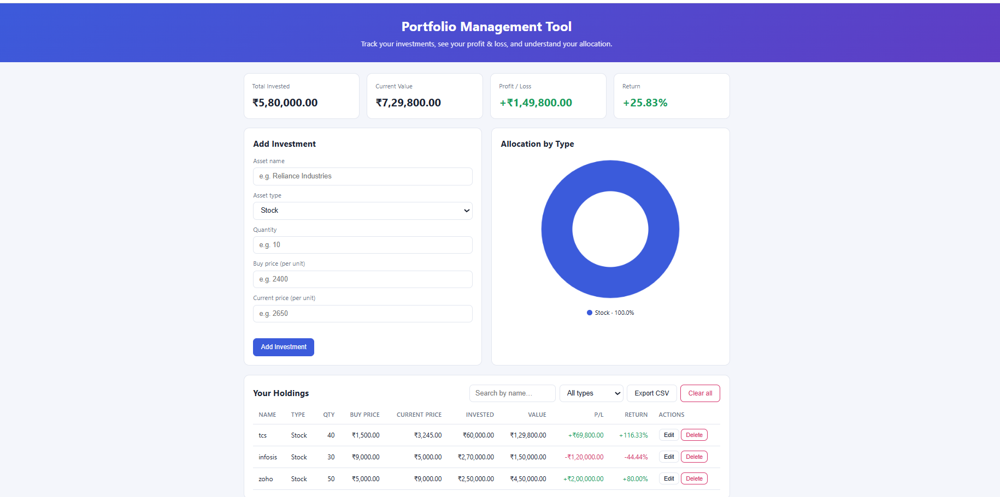

# Portfolio Management Tool

A simple, clean web app to track your investments, calculate profit & loss, and see how your money is spread across asset types. It runs fully in the browser: no backend, no installation, no sign-up.
## Screenshot



## Features

- Add, edit and delete investments (stocks, mutual funds, crypto, gold, bonds, other)
- Automatic calculation of invested amount, current value, profit/loss and return %
- Summary cards for the whole portfolio
- Allocation donut chart by asset type (drawn with the Canvas API, no libraries)
- Search by name and filter by asset type
- Export your holdings to a CSV file
- Data is saved in your browser using `localStorage`
- Responsive layout for desktop and mobile

## Tech Stack

- HTML5
- CSS3 (Grid, Flexbox, CSS variables)
- Vanilla JavaScript (ES6)

## Project Structure

```
Portfolio_Management_GitHub_Project/
├── index.html        # Page structure
├── style.css         # Styling
├── script.js         # App logic
├── README.md
├── .gitignore
├── assets/           # Images / screenshots
└── docs/
    └── project-report.md
```

## How to Run

1. Download or clone this repository.
2. Open `index.html` in any modern browser.

That is all. No build step is needed.

## How It Works

| Value | Formula |
|-------|---------|
| Invested | Quantity × Buy price |
| Current value | Quantity × Current price |
| Profit / Loss | Current value − Invested |
| Return % | (Profit / Loss ÷ Invested) × 100 |

Current prices are entered by you. The app does not fetch live market data.

## Future Improvements

- Live price updates using a market data API
- Multiple portfolios
- Line chart of portfolio value over time
- Import from CSV
